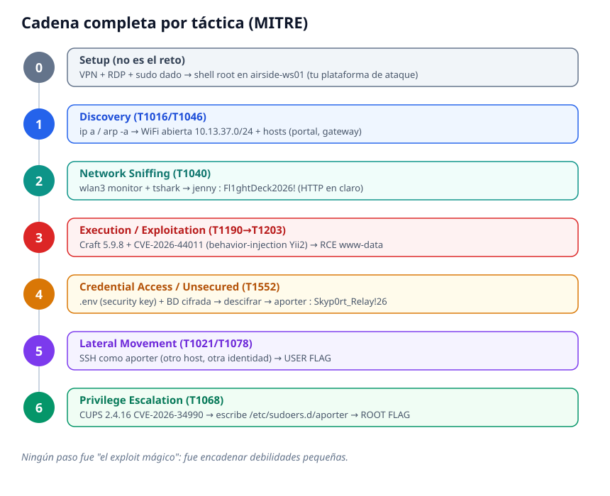

# Layover — la manufactura del walkthrough

Este sitio documenta **cómo se construyó** la solución de la máquina HackTheBox **Layover**,
no solo *qué* comandos se corrieron. El foco es el razonamiento: cada etapa sigue el ciclo
**razonar → deducir → testear → concluir → re-iterar**.

!!! info "Cómo está organizado"
    Separamos el **Setup** (cómo recibes tu plataforma de ataque: VPN, RDP) del **CTF real**
    (el juego deductivo, que empieza con un shell en el workstation). Cada página es una
    **táctica MITRE ATT&CK**: un *objetivo* al que se puede llegar por varias *técnicas*.

## La cadena completa

<figure>
  
</figure>

## Datos de la máquina

| Campo | Valor |
|---|---|
| Plataforma | HackTheBox |
| Nombre | Layover |
| IP de entrada | `10.129.247.82` |
| Credenciales dadas | `contractor : Contractor2026!` |
| Acceso inicial | RDP (3389) → `airside-ws01` |
| Red objetivo | WiFi abierta `10.13.37.0/24` |
| Flags | User (SSH `aporter`) · Root (CUPS) |

## Índice de tácticas

- **0 · [Setup](etapa0-setup.md)** — VPN, servicios expuestos y acceso por RDP
- **1 · [Discovery](01-discovery.md)** — descubrir la red `10.13.37.0/24`
- **2 · [Network Sniffing](02-monitoreo.md)** — capturar `jenny`
- **3 · [Exploitation](03-exploitation.md)** — RCE en Craft (CVE-2026-44011)
- **4 · [Credenciales](04-credenciales.md)** — descifrar a `aporter`
- **5 · [Lateral Movement](05-lateral.md)** — SSH → user flag
- **6 · [Privilege Escalation](06-privesc.md)** — CUPS → root flag

!!! tip "La pregunta de oro para el re-run"
    En cada táctica pregúntate: *¿era esta la única forma de llegar a la misma conclusión,
    o solo la primera que encontré?* Ahí está el aprendizaje.
