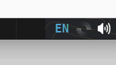
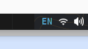
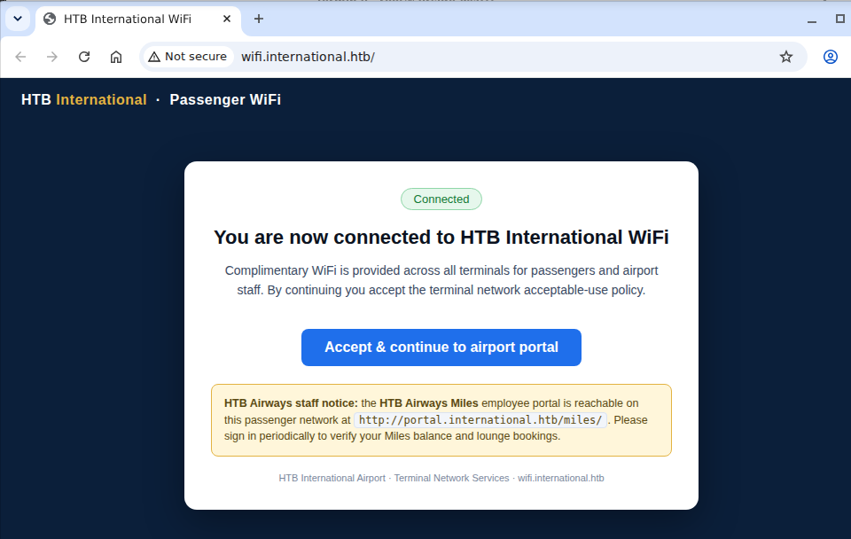
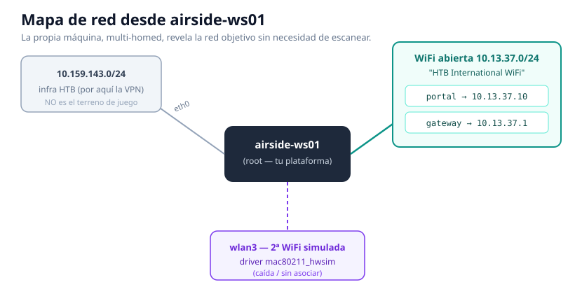

# 1 · Discovery  (T1016 / T1046)

**Objetivo:** descubrir que existe la red WiFi `10.13.37.0/24` y qué hosts viven en ella.

## 1.1 · Orientación

Acabas de ganar un shell en una máquina de la que no sabes nada. Antes de mirar la red, oriéntate.
Tres preguntas, lo mínimo imprescindible:

**¿Qué host es este?** (sistema y kernel)

```bash
hostname             # airside-ws01 → hay más "estaciones"
lsb_release -a       # distro y versión
cat /etc/os-release  # lo mismo, si no está lsb_release
uname -a             # kernel → relevante para privesc
```

**¿Quién soy?** (privilegios y grupos)

```bash
id                   # uid, gid y grupos de un vistazo
groups               # ← ojo al grupo `wireshark`: pista enorme
sudo -l              # ¿qué puedo ejecutar como root?
```

??? note "🔍 Analizar el output de `id` (clic)"
    ```text
    uid=1001(contractor) gid=1001(contractor) groups=1001(contractor),27(sudo),111(netdev),121(wireshark)
    ```

    Formato `número(nombre)`: el **número** lo usa el kernel; el **nombre** es la etiqueta de `/etc/group`.

    - **`uid=1001(contractor)`** → quién eres. `uid=0` sería root; los humanos suelen ir desde 1000.
    - **`gid=1001(contractor)`** → tu grupo **principal** (dueño por defecto de los archivos que creas).
    - **`groups=...`** → **todos** tus grupos = tu superficie de ataque. Los que importan:
        - `27(sudo)` → 🔴 ejecutar como **root** con `sudo`.
        - `111(netdev)` → gestionar **interfaces de red** sin ser root.
        - `121(wireshark)` → **capturar tráfico de red** sin ser root.

    Que un usuario normal pueda **capturar tráfico** y **tocar interfaces de red** sin root es poco
    común → capacidades a tener muy presentes.

??? note "🔍 Analizar el output de `sudo -l` (clic)"
    ```text
    Matching Defaults entries for contractor on airside-ws01:
        env_reset, mail_badpass, secure_path=/usr/local/sbin:...:/snap/bin, use_pty

    User contractor may run the following commands on airside-ws01:
        (ALL : ALL) ALL
    ```

    `sudo -l` lista **qué puedes ejecutar con sudo**. La línea que importa es la última:

    - **`(ALL : ALL) ALL`** se lee `(usuarios : grupos) comandos`:
        - 1.º `ALL` → como **cualquier usuario** (incluido root).
        - 2.º `ALL` → como **cualquier grupo**.
        - 3.º `ALL` → **cualquier comando**, sin restricción.
    - Traducción: **sudo total** → `sudo -i` da un shell root inmediato.
    - Los *Defaults* de arriba (`env_reset`, `secure_path`, `use_pty`…) son políticas de seguridad; **no** limitan *qué* puedes correr.

    ⚠️ Root aquí es **parte de la plataforma que te entregan**, no una escalada que hayas ganado.

**¿Dónde estoy?** (interfaces y rutas) — y aquí ya empieza el discovery de red

```bash
ip a                 # interfaces e IPs
ip route             # qué redes alcanzo
arp -a               # vecinos ya conocidos
```

??? note "🔍 Analizar el output de `ip a` (clic)"
    ```text
    1:  lo    <LOOPBACK,UP>            inet 127.0.0.1/8
    6:  wlan2 <NO-CARRIER,...,UP> DOWN link/ether 02:00:00:00:02:00   (sin IP)
    7:  wlan3 <NO-CARRIER,...,UP> DOWN link/ether 02:00:00:00:03:00   (sin IP)
    10: eth0@if11 <...,UP,LOWER_UP> UP link/ether 00:16:3e:83:ea:41
        inet 10.159.143.45/24 scope global dynamic eth0
    ```

    - **`lo`** → loopback (127.0.0.1). Irrelevante.
    - **`eth0` es la ÚNICA con IP**: `10.159.143.45/24` → estás en la red **10.159.143.0/24**.
    - **`eth0@if11` + `link-netnsid 0`** → es un **veth** (par virtual) → estás dentro de un **contenedor**.
    - **MAC `00:16:3e:…`** (eth0 y el gateway) → OUI de **Xen/LXD** → confirma contenedor LXD.
    - **`wlan2` y `wlan3`: `DOWN`, `NO-CARRIER`, sin IP** → hay **dos adaptadores WiFi** pero **no asociados** a ninguna red aún.
    - **MACs WiFi `02:00:00:00:0X:00`** → secuenciales y "`02:`" (localmente administradas) = **adaptadores simulados** (`mac80211_hwsim`), no hardware real.
    - **Deducción:** tienes **dos adaptadores WiFi simulados pero caídos**. El siguiente paso natural es **levantarlos y ver qué hay en el aire**.

??? note "🔍 Analizar el output de `ip route` (clic)"
    ```text
    default via 10.159.143.1 dev eth0 proto dhcp src 10.159.143.45
    10.159.143.0/24 dev eth0 proto kernel scope link src 10.159.143.45
    10.159.143.1 dev eth0 proto dhcp scope link src 10.159.143.45
    ```

    - **Todo va por `eth0`** → la única red que alcanzas ahora es **10.159.143.0/24**.
    - **`default via 10.159.143.1`** → tu salida es el gateway `.1`.
    - **`proto dhcp`** → `eth0` se configuró por **DHCP**, no estático.

??? note "🔍 Analizar el output de `arp -a` (clic)"
    ```text
    _gateway.lxd (10.159.143.1) at 00:16:3e:ca:62:2e [ether] on eth0
    ```

    - **Un solo vecino conocido**: el gateway `10.159.143.1`.
    - **`_gateway.lxd`** → el sufijo **`.lxd`** confirma entorno **LXD** (contenedores).
    - **MAC `00:16:3e:…`** → otra vez el OUI de Xen/LXD.
    - **Nada más en la tabla** → en la red de infraestructura no hay otros hosts interesantes; el juego está en la WiFi (que aún debes conectar).

??? tip "¿Hasta dónde llega 'conocer el hardware'? (clic)"
    Perfilar CPU/RAM/disco suele ser **exagerado** en un CTF. La única pieza de "hardware" que
    importa aquí son las **interfaces de red**. Por si quieres explorar esa parte:

    ```bash
    lspci                # dispositivos PCI (verás los adaptadores WiFi)
    ethtool -i wlan2     # driver de la interfaz → mac80211_hwsim
    dmesg | grep hwsim   # confirma que las WiFi son simuladas
    iw dev               # interfaces inalámbricas y su modo
    ```

    `mac80211_hwsim` = WiFi **simulada**. Eso sí es señal; CPU/RAM/disco, ruido.

Dos cosas a retener de esta orientación: estás en el grupo **`wireshark`** (puedes capturar tráfico)
y la máquina **no tiene internet** →

???+ danger "Restricción del entorno (clave)"
    `airside-ws01` **no tiene salida a internet** (`apt` devuelve `Ign:`). → **no se puede instalar
    nada**: ni `nmap`, ni `netdiscover`, ni `ffuf`. Hay que usar solo lo que ya está instalado.

    ¿Y qué hay "presente"? Dos formas de averiguarlo:

    ```bash
    compgen -c | sort -u
    ```
    ```bash
    command -v curl wget python3 nc ncat socat ssh scp nmap tcpdump tshark gobuster ffuf git
    ```

    - `compgen -c` → **todos** los comandos que el shell puede ejecutar.
    - `command -v <lista>` → **busca aplicaciones concretas** e imprime solo las que existen. Aquí
      confirma que están `curl wget python3 nc ssh scp tcpdump tshark git` y que **faltan**
      `nmap gobuster ffuf` → por eso toca usar solo lo instalado o pivotar.

## 1.2 · Enfoque

> *"No tengo escáneres. ¿Qué sabe la máquina de la red **sin preguntarle a nadie**?"*

La propia máquina ya está **conectada** a la red objetivo. Su configuración te lo revela gratis.

## 1.3 · Procedimiento

**Estado inicial — enumeramos lo que hay:**

```bash
ip a            # interfaces e IPs
ip route        # redes alcanzables
arp -a          # vecinos conocidos
```

- La **única interfaz con IP** es **`eth0` (`10.159.143.45/24`)** → estás en la red de
  infraestructura `10.159.143.0/24`. `arp -a` solo muestra su gateway; nada más.
- **`wlan2` y `wlan3` están `DOWN` (apagadas), sin IP.** Hay dos adaptadores WiFi (simulados,
  `mac80211_hwsim`) pero **no conectados** a ninguna red. La bandeja del sistema lo confirma:

<figure>
  
  <figcaption>Bandeja del sistema: la WiFi está apagada (estado inicial).</figcaption>
</figure>

**Levantar la WiFi** — las interfaces están caídas, así que subimos `wlan2` y escaneamos qué hay:

```bash
ip link set wlan2 up
iw dev wlan2 scan | grep SSID
#   SSID: HTB International WiFi      ← hay una red a la vista
```

Intentamos asociarla a mano… y los **errores nos enseñan algo**:

```bash
iw dev wlan2 connect "HTB International WiFi"
# command failed: Operation already in progress (-114)
dhclient wlan2
# Command 'dhclient' not found
```

- **`Operation already in progress (-114)`** → un **gestor de conexión del sistema** ya está
  asociando `wlan2` a la red abierta por su cuenta; no hay que hacerlo a mano.
- **`dhclient` no está** (y sin internet no se puede instalar) → tampoco necesitas pedir DHCP
  manualmente: ese mismo gestor obtiene la IP.

Moraleja: **bastó con subir la interfaz** — el sistema la asocia a la red abierta y toma el lease
solo. Lo confirma el `ip a` de más abajo.

Ahora la WiFi aparece **conectada** a una red:

<figure>
  
  <figcaption>Bandeja del sistema: WiFi conectada.</figcaption>
</figure>

**La página de bienvenida te revela el objetivo** — ni bien coges conexión con esa red, `wifi.international.htb` abre automáticamente una página:

<figure>
  
  <figcaption>La página que aparece automáticamente al conectar: confirma la conexión y revela el portal Miles.</figcaption>
</figure>

> *"You are now connected to HTB International WiFi … the HTB Airways Miles employee portal is
> reachable on this passenger network at `http://portal.international.htb/miles/`."*

- **SSID:** `HTB International WiFi` (abierta, para "pasajeros").
- **Página de bienvenida:** `wifi.international.htb`.
- **Objetivo revelado por la propia página:** **`portal.international.htb/miles/`**.

`ip a` confirma dónde has aterrizado — `wlan2` pasó de caída a **`UP`** con IP en el segmento WiFi:

```text
6: wlan2: <BROADCAST,MULTICAST,UP,LOWER_UP> mtu 1500 qdisc noqueue state UP group default qlen 1000
    link/ether 02:00:00:00:02:00 brd ff:ff:ff:ff:ff:ff
    inet 10.13.37.182/24 brd 10.13.37.255 scope global dynamic noprefixroute wlan2
       valid_lft 41778sec preferred_lft 41778sec
    inet6 fe80::a9cf:a989:ceb6:e9d8/64 scope link noprefixroute
7: wlan3: <NO-CARRIER,BROADCAST,MULTICAST,UP> mtu 1500 qdisc noqueue state DOWN group default qlen 1000
    link/ether 02:00:00:00:03:00 brd ff:ff:ff:ff:ff:ff
10: eth0@if11: <BROADCAST,MULTICAST,UP,LOWER_UP> mtu 1500 qdisc noqueue state UP group default qlen 1000
    link/ether 00:16:3e:83:ea:41 brd ff:ff:ff:ff:ff:ff link-netnsid 0
    inet 10.159.143.45/24 metric 100 brd 10.159.143.255 scope global dynamic eth0
       valid_lft 3100sec preferred_lft 3100sec
```

- **`wlan2`**: de `DOWN` a **`UP`**, con **`10.13.37.182/24`** por DHCP → ya estás dentro de `10.13.37.0/24`.
- **`wlan3`**: sigue caída → disponible.
- **`eth0`**: sin cambios (la red de infra).

Ya en el segmento WiFi, podrías **enumerarlo** (el portal, otros hosts) antes de nada. Pero hay una
observación que abre una vía más jugosa:

!!! question "Conjetura: el puente hacia la captura de tráfico"
    - La WiFi es **abierta** (sin cifrado) → cualquiera en el canal ve el tráfico de todos.
    - El portal se sirve por **HTTP** (la propia página de bienvenida es `http://`, sin TLS) y **pide iniciar sesión**.
    - **Si** otros usuarios se conectan a esta misma red y se loguean…
    - **¿…podríamos capturar su tráfico inalámbrico y leer esas credenciales?**

    Es una **hipótesis**, no un hecho: hay que montar la captura y comprobarlo. Eso es justo lo que
    exploramos a continuación.

## 1.4 · Conclusión

Tras asociarte a la WiFi abierta estás dentro de **`10.13.37.0/24`**, y la **página de bienvenida te ha
revelado el objetivo**: `portal.international.htb/miles/` (el portal Miles de HTB Airways).

<figure>
  
  <figcaption>Topología resultante: infra por `eth0`, y el segmento WiFi `10.13.37.0/24` con el portal.</figcaption>
</figure>

## 1.5 · Root en el workstation

Antes de capturar tráfico necesitamos privilegios. El workstation nos los **regala**:

```bash
sudo -l          # (ALL : ALL) ALL
sudo -i          # uid=0(root)
```

???+ danger "Esto NO es el privesc del reto"
    El workstation te concede **sudo total de entrada**: root aquí es **parte de la plataforma que
    te entregan**, no un objetivo que hayas tenido que ganar. Tenerlo te permitirá hacer cosas que
    requieren privilegios en los pasos siguientes — no lo confundas con una escalada conseguida por ti.

## 1.6 · Rutas alternativas

- `ip neigh` / `cat /proc/net/arp` — equivalentes a `arp -a`.
- `ip route` — qué redes alcanza la máquina.
- `/etc/hosts`, config DHCP, `resolv.conf` — dominio `international.htb`.
- `iw dev` + `/sys/class/net/*/phy80211/` — confirmar que son interfaces simuladas.
- `tcpdump -i wlan2` unos segundos — ver qué direcciones aparecen solas.
- `netdiscover` **no** se usó y **no se puede instalar** aquí → queda como ejercicio teórico.

??? note "📸 Captura"
    *(Espacio para la salida de `ip a` resaltando `wlan2` con su IP `10.13.37.182/24`.)*

**Siguiente:** [Táctica 2 · Network Sniffing](02-monitoreo.md)
