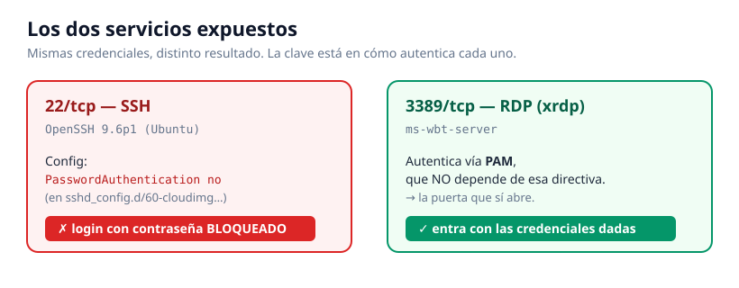
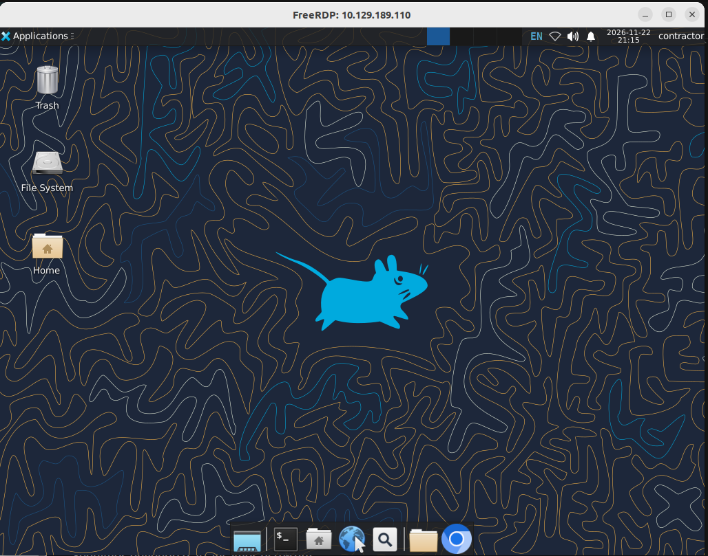

# Etapa 0 · Setup

Aquí **no hay deducción**: la máquina te lo entrega. Es cómo llegas a tener un shell en el
workstation —VPN, los servicios expuestos y el comando de entrada—. El verdadero juego empieza
después, en [Discovery](01-discovery.md).

---

## 0.1 · La VPN

OpenVPN levanta la interfaz `tun0` y **enruta** tu tráfico hacia la red del laboratorio. Sin
esto, tus paquetes nunca alcanzan `10.129.x.x`. No es atacar nada: es conectar tu máquina a la red.

```bash
sudo openvpn machines_us-4.ovpn
```

???+ success "Marcador de éxito"
    La VPN está arriba **solo** cuando aparece la línea:
    ```
    Initialization Sequence Completed
    ```
    Mientras no esté, NO estás conectado aunque el proceso siga vivo. Verifica siempre:
    ```bash
    ip a            # interfaz tun0 con IP 10.10.x.x
    ping -c3 10.129.247.82
    ```

??? note "Incidencia real de esta sesión"
    El primer `.ovpn` se quedaba en `TLS handshake failed` por el camino **UDP 1337**. Se
    resolvió cambiando a otro servidor / a **TCP 443** (443 es HTTPS: ninguna red lo bloquea).
    Detalle en `logs/vpn_connectivity.md`.

??? bug "Troubleshooting real: la VPN dice *Completed* pero NO llego a la máquina"
    **Síntoma.** La VPN conecta sin error (`Initialization Sequence Completed`), pero RDP falla:

    ```
    xfreerdp ... /v:10.129.247.82 ...
    [ERROR][com.freerdp.core] - freerdp_tcp_connect: ERRCONNECT_CONNECT_FAILED [0x00020006]
    [ERROR][com.freerdp.core] - failed to connect to 10.129.247.82
    ```

    **Trampa mental.** El log de OpenVPN está impecable —hasta instala la ruta correcta—:
    ```
    PUSH_REPLY,... route 10.129.0.0 255.255.0.0 ...
    net_route_v4_add: 10.129.0.0/16 via 10.10.16.1 dev tun1
    Initialization Sequence Completed
    ```
    Tentación: culpar a la VPN. **Pero la VPN no es el problema** — el túnel está arriba. Hay que
    bajar un nivel y mirar el **enrutamiento**.

    **El reflejo de diagnóstico** (de fuera hacia dentro):

    ```bash
    pgrep -a openvpn            # ¿cuántas VPN hay corriendo?
    ip -br link show type tun   # ¿hay túneles colgados (tun0, tun1, ...)?
    ip route get 10.129.247.82  # ¿por QUÉ túnel sale el tráfico a la máquina?
    ping -c3 10.129.247.82      # ¿llega el host?
    nc -zv 10.129.247.82 3389   # ¿está arriba el puerto RDP?
    ```

    **Lo que encontramos:** dos OpenVPN vivos a la vez, de servidores **distintos**:

    ```
    openvpn machines_us-5.ovpn   → tun0   (zombi de una sesión anterior, ~4 h)
    openvpn machines_us-4.ovpn   → tun1   (el nuevo, el de Layover)
    ```

    Las dos instalaron la **misma** ruta a `10.129.0.0/16`, y solo una puede ganar:

    ```
    ip route get 10.129.247.82
    → 10.129.247.82 via 10.10.16.1 dev tun0   ← ¡sale por el VIEJO (us-5)!
    ```

    Tus paquetes RDP se iban por el túnel equivocado, hacia un servidor que **no** tiene enrutada tu
    máquina → `ping` 0/3, puerto `3389` cerrado, `CONNECT_FAILED`.

    **La causa (dos cosas a la vez):**

    1. **Técnica:** a un mismo destino (`10.129.0.0/16`) solo puede apuntar **una** ruta efectiva; el
       túnel zombi la robó.
    2. **De HTB:** solo admite **una** sesión VPN activa por cuenta.

    **El arreglo — dejar UNA sola VPN limpia:**

    ```bash
    sudo pkill -f openvpn               # 1) matar TODAS las VPN
    ip -br link show type tun           #    verificar: tun0/tun1 deben desaparecer
    pgrep -a openvpn || echo "sin openvpn: OK"
    sudo openvpn .../machines_us-4.ovpn # 2) reconectar SOLO la de Layover
    ping -c3 10.129.247.82 && nc -zv 10.129.247.82 3389   # 3) re-test antes de RDP
    ```

    Con una sola VPN, la ruta a `10.129.x` apunta al servidor correcto y la máquina aparece:

    ```
    64 bytes from 10.129.247.82: icmp_seq=1 ttl=63 time=99.4 ms   ← ping OK
    3389 ABIERTO ✓                                                 ← RDP escuchando
    ```

    **Lección:** *antes* de conectar la VPN, comprueba que no haya otra colgada (`pgrep -a openvpn`,
    `ip -br link show type tun`). Un **túnel zombi** de una sesión previa es un clásico de
    "la VPN dice *Completed* pero no llego a la máquina". Y si tras limpiar sigue sin responder, el
    problema ya no es red sino la **máquina**: apagada, o con **IP nueva** tras un respawn (HTB rota
    la IP) — verifícalo en el panel.

---

## 0.2 · Los dos servicios expuestos

Lo único que encuentra un escaneo de puertos:

```
22/tcp   open  ssh           OpenSSH 9.6p1 (Ubuntu)
3389/tcp open  ms-wbt-server xrdp
```

- **22 (SSH):** acceso por línea de comandos.
- **3389 (RDP / xrdp):** escritorio remoto gráfico.

Con credenciales en mano, el reflejo es SSH. Pero el intento es **rechazado**:

```bash
ssh contractor@10.129.247.82
# contractor@10.129.247.82: Permission denied (publickey,password).
```

Ese es el **mismo** mensaje que verías con una contraseña incorrecta: no distingue "credencial
mala" de "acceso denegado por política".

Intentemos con otro servicio: RDP.

---

## 0.3 · El comando xfreerdp

El comando con el que entramos:

```bash
xfreerdp /u:contractor /p:'Contractor2026!' /v:10.129.247.82 \
         /cert:ignore +clipboard /dynamic-resolution
```

Pieza por pieza (se construye, no se memoriza):

- `xfreerdp` — el cliente RDP de FreeRDP (abre el escritorio remoto).
- `/u:contractor` — **usuario** con el que te autenticas.
- `/p:'Contractor2026!'` — **contraseña**; comillas simples porque el `!` es especial para el shell.
- `/v:10.129.247.82` — **víctima / destino** (`IP[:puerto]`; `:3389` es el default, por eso se omite).
- `/cert:ignore` — xrdp usa un **certificado autofirmado**; sin esto el cliente se detiene a preguntar.
- `+clipboard` — portapapeles compartido host⇄remoto (pegar comandos/creds cómodamente).
- `/dynamic-resolution` — la ventana se adapta al redimensionar (opcional).

??? tip "Convención `/` vs `+` (clic para ver)"
    En FreeRDP, `/opcion:valor` **configura** algo y `+opcion` / `-opcion` **activa / desactiva**
    una función. Por eso es `+clipboard` (activar) y `/cert:ignore` (configurar).

??? question "Opcional: ¿por qué SSH rechazaba la conexión? (curiosidad, no es clave)"
    Ya dentro por RDP, inspeccionamos la config de SSH desde la terminal:

    ```bash
    grep -ri passwordauthentication /etc/ssh/
    # /etc/ssh/sshd_config.d/60-cloudimg-settings.conf:PasswordAuthentication no
    ```

    Un **drop-in** (`/etc/ssh/sshd_config.d/60-cloudimg-settings.conf`) con `PasswordAuthentication
    no` desactiva el login por contraseña vía SSH. En cambio, `xrdp` autentica vía **PAM**, que *no*
    se ve afectado por esa directiva → por eso RDP sí abría.

    <figure>
      
    </figure>

    **Lección:** cuando SSH rechaza una contraseña que *sabes* correcta, revisa `sshd_config` **y**
    `sshd_config.d/`. Un override en un drop-in es fácil de pasar por alto.

<figure>
  
  <figcaption>Sesión RDP establecida: el escritorio XFCE de <code>airside-ws01</code> como
  <code>contractor</code>. Ya estamos dentro — aquí empieza el trabajo real.</figcaption>
</figure>

---

**Siguiente:** ya conectados, empieza el verdadero juego: descubrir la red donde vive el objetivo
→ [Táctica 1 · Discovery](01-discovery.md)
