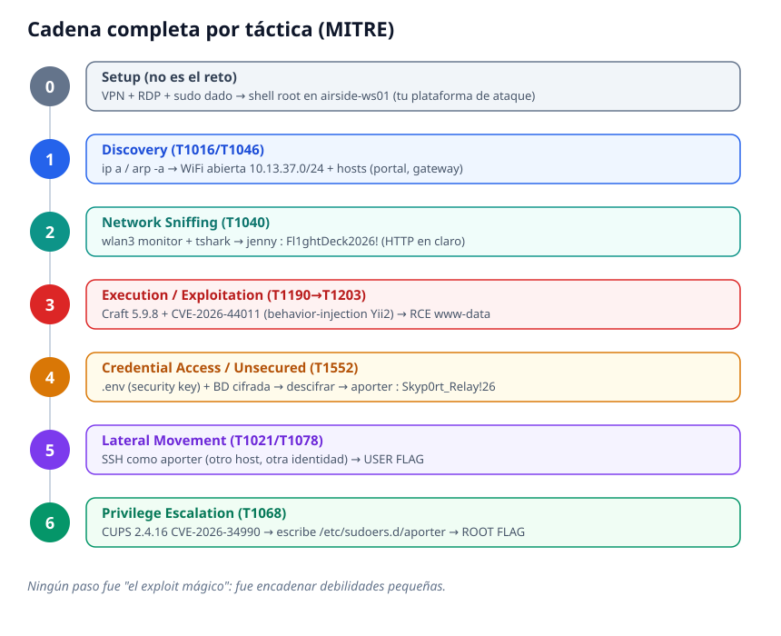

# Layover

Este sitio documenta **cómo se construyó** la solución de la máquina HackTheBox **Layover**,
no solo qué comandos se corrieron. El foco es el razonamiento: cada etapa sigue el ciclo de razonar,
deducir, probar, concluir y repetir.

!!! info "Cómo está organizado"
    Separamos el **Setup** (cómo recibes tu plataforma de ataque: VPN, RDP) del **CTF real**
    (el juego deductivo, que empieza con un shell en el workstation). Cada página es una
    **táctica MITRE ATT&CK**: un *objetivo* al que se puede llegar por varias *técnicas*.

## La cadena completa

<figure>
  
</figure>

## Datos de la máquina

| Campo | Valor |
|---|---|
| Plataforma | HackTheBox |
| Nombre | Layover |
| IP de entrada | `10.129.247.82` |
| Credenciales dadas | `contractor : Contractor2026!` |
| Acceso inicial | RDP (3389) → `airside-ws01` |
| Red objetivo | WiFi abierta `10.13.37.0/24` |
| Flags | User (SSH `aporter`) · Root (CUPS) |

## Índice de tácticas

- **0 · [Setup](etapa0-setup.md)** — VPN, servicios expuestos y acceso por RDP
- **1 · [Discovery](01-discovery.md)** — descubrir la red `10.13.37.0/24`
- **2 · [Network Sniffing](02-monitoreo.md)** — capturar `jenny`
- **🎯 [Tarea](tarea.md)** — crea tu blog en GitHub Pages y documenta tu avance (0 → 2)

!!! note "Tácticas 3–6: no publicadas"
    La cadena de explotación (Execution → Credential Access → Lateral Movement → Privesc a root)
    **no** se publica, para no dar la solución. Tu trabajo está en la **[Tarea](tarea.md)**: montar
    tu propio blog MkDocs y documentar con capturas tu recorrido de la Etapa 0 a la Táctica 2.

!!! tip "Al terminar cada táctica"
    Pregúntate si esa era la única forma de llegar a la conclusión, o solo la primera que encontraste.
    Buscar rutas alternativas suele enseñar más que la solución en sí.
